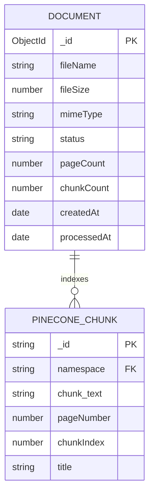

# Database Design

## Storage technologies

- **MongoDB** (Mongoose) stores one metadata record per uploaded PDF.
- **Pinecone Documents API** stores and searches extracted text chunks. It is a separate search store, not a MongoDB relational table.

## MongoDB collection: `documents`

Mongoose model: `PdfDocument`. MongoDB supplies `_id` as the primary key and `createdAt` through timestamps.

| Field | Type | Required | Notes |
|---|---|---:|---|
| `_id` | ObjectId | yes | Primary key; string form is the Pinecone namespace and public API document ID. |
| `fileName` | String | yes | Trimmed original file name; display metadata only. |
| `fileSize` | Number | yes | File size in bytes. |
| `mimeType` | String | yes | Browser-provided MIME type, defaulted to `application/pdf` if absent. |
| `status` | String enum | yes | `processing`, `completed`, or `failed`; defaults to `processing`; indexed. |
| `pageCount` | Number | yes | Defaults to zero until processing completes. |
| `chunkCount` | Number | yes | Defaults to zero until processing completes. |
| `errorMessage` | String | no | Safe user-facing processing failure message. |
| `createdAt` | Date | yes | Automatically set at insert. |
| `processedAt` | Date | no | Set after successful indexing. |

The schema currently disables `updatedAt`. There is no owner/user ID because authentication does not exist.

## Pinecone documents

Each text chunk is upserted with `_id = <mongoDocumentId>-<chunkIndex>` in namespace `<mongoDocumentId>`.

| Field | Type | Purpose |
|---|---|---|
| `_id` | String | Stable chunk key within the namespace. |
| `chunk_text` | String | Extracted page text; configured for integrated embedding and semantic search. |
| `title` | String | Original PDF filename. |
| `documentId` | String | Mongo document ID, retained as a field. |
| `pageNumber` | Number | PDF page associated with the chunk. |
| `chunkIndex` | Number | Zero-based chunk sequence for the document. |

Chunks are generated per page using a 1,000-character maximum and 200-character overlap. The namespace itself isolates each PDF's search corpus.

## Relationships

The relationship is logical: Pinecone's namespace equals the MongoDB document ID. MongoDB does not store a separate chunk table or a foreign key.

## Constraints, access, and indexes

- `fileName`, `fileSize`, `mimeType`, and `status` are required. Status is restricted to the three lifecycle values.
- API validation limits PDFs to 10 MB and rejects empty files, non-`.pdf` names, and invalid PDF signatures.
- `status` has an index for status-based filtering. The document list query sorts by `createdAt` descending; consider `{ createdAt: -1 }` if collection size warrants it.
- Pinecone chunk lookup occurs inside the document namespace; retrieval does not need cross-document filtering.
- There are no row-level security rules or per-user ownership controls in the current app. All API callers can list metadata and address a document ID. Do not deploy publicly until an ownership/authentication design is added.

## Sensitive data

PDF bytes are not stored in MongoDB. Extracted text is sent to Pinecone and relevant chunks are sent to OpenRouter for answers. File names, processing state, and counts remain in MongoDB. Treat extracted text and prompts as user content; keep provider keys private and avoid logging full text or prompts.

## Migrations, seeds, backup, and recovery

- No migration framework or seed data is currently configured. Mongoose schema changes must be accompanied by a documented, reversible migration/backfill plan when they affect existing data.
- No application-driven backups or restore verification are configured. Use the selected MongoDB provider's backup/restore controls and Pinecone's supported backup/export approach before production launch.
- Upload failure attempts to delete partially indexed Pinecone documents and then marks the Mongo record failed. Cleanup failure is logged; reconciliation is currently manual.
- Retention and deletion rules are undecided and need product approval before implementation.
